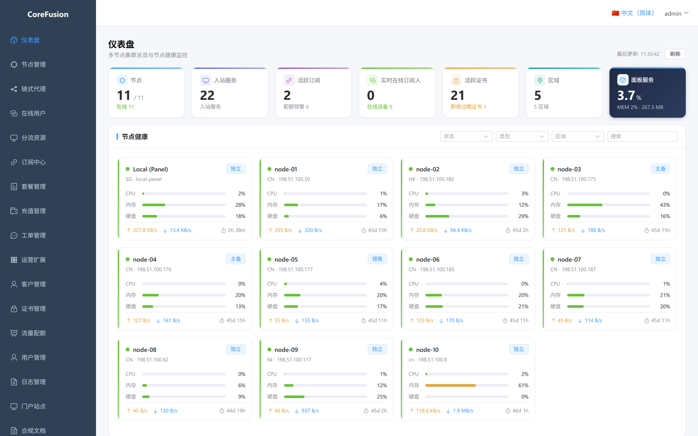
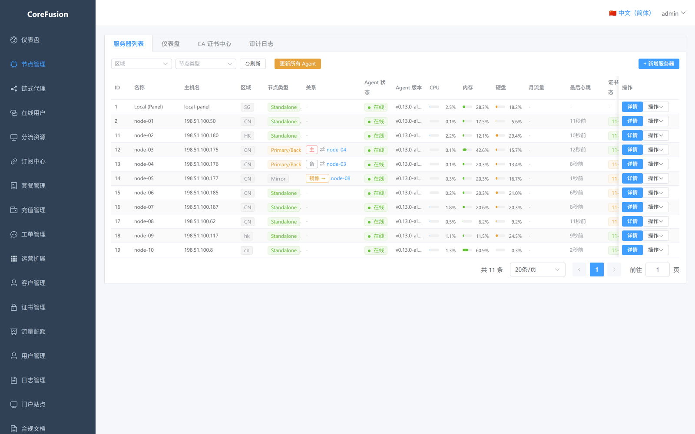
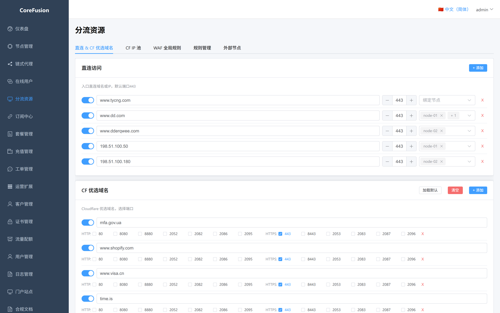
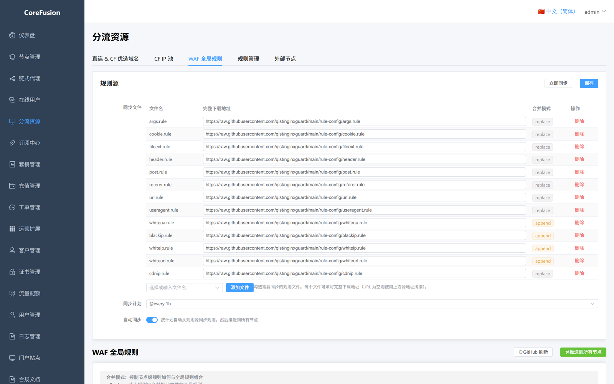
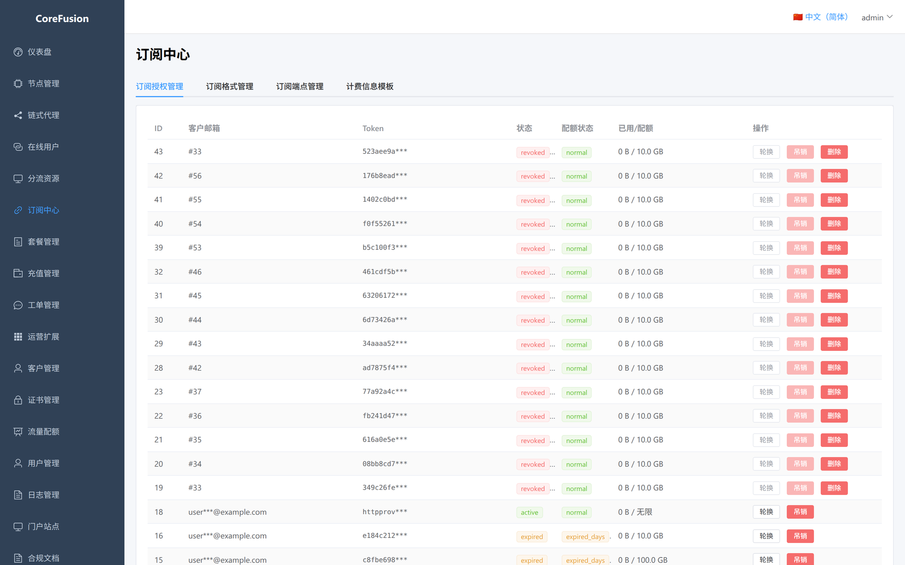
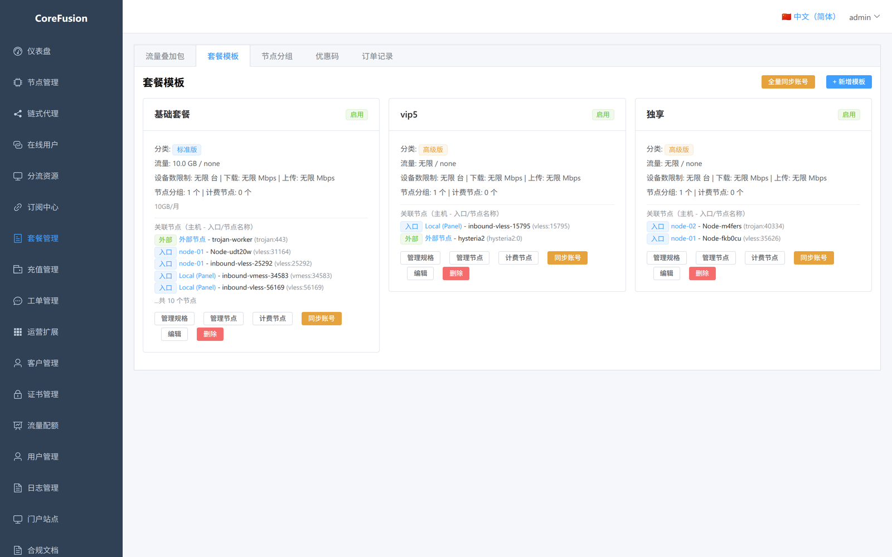
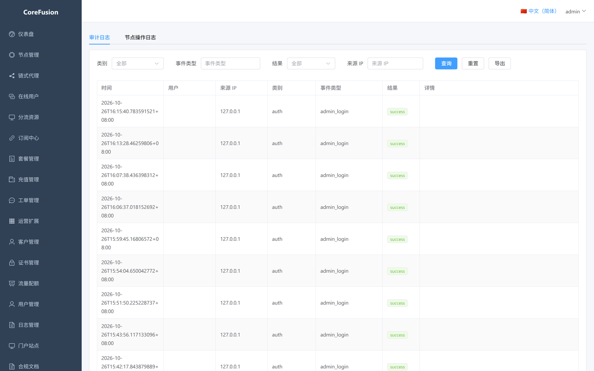
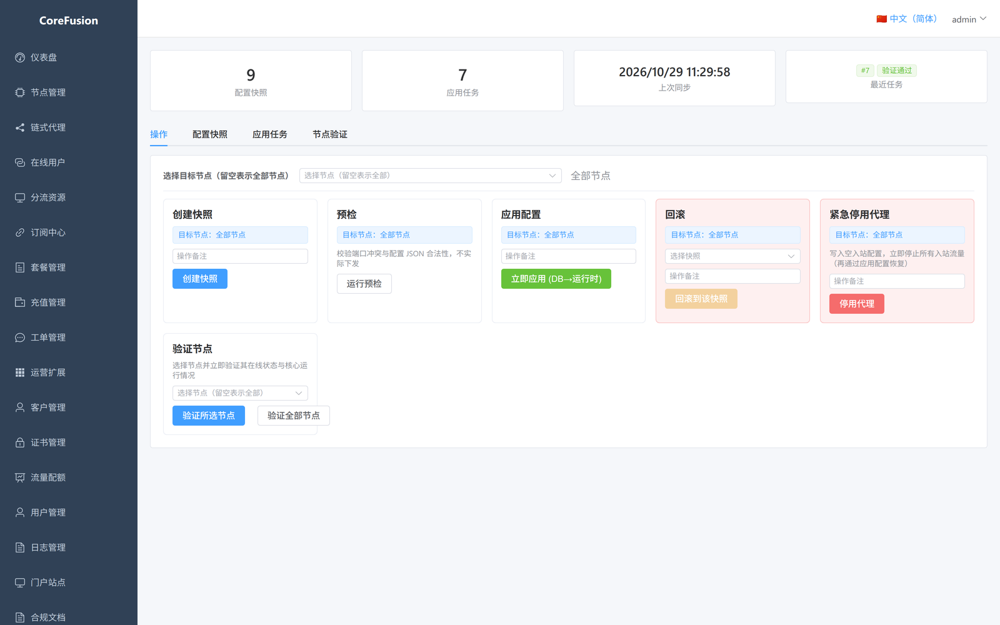

<!-- source: README.md | locale: en | updated: 2026-10-29 -->
# CoreFusion

> Languages: [简体中文](README.md) · English · [繁體中文](README.zh-TW.md) · [Русский](README.ru.md) · [日本語](README.ja.md) · [한국어](README.ko.md) · [Deutsch](README.de.md) · [Français](README.fr.md) · [Español](README.es.md) · [Português](README.pt.md) · [Türkçe](README.tr.md) · [Bahasa Indonesia](README.id.md) · [ไทย](README.th.md) · [Tiếng Việt](README.vi.md) · [العربية](README.ar.md) · [فارسی](README.fa.md)

Proxy service operations panel (Panel + Agent + client portal): manage nodes and Agents, inbound and subscription delivery, plans / orders / payments, certificate issuance, traffic accounting and rate limiting from one place.

## Screenshots

> Captured in a test environment; IPs, domains, e-mail addresses and node names have been redacted.

| Dashboard | Node management |
|:---:|:---:|
| [](./docs/screenshots/dashboard.png) | [](./docs/screenshots/node-servers.png) |

| Routing resources (direct domains) | Routing resources (global WAF rules) |
|:---:|:---:|
| [](./docs/screenshots/services-domains.png) | [](./docs/screenshots/services-waf.png) |

| Subscription center | Plan templates |
|:---:|:---:|
| [](./docs/screenshots/subscriptions.png) | [](./docs/screenshots/plans.png) |

| Audit log | Runtime console |
|:---:|:---:|
| [](./docs/screenshots/audit.png) | [](./docs/screenshots/runtime.png) |

## Documentation

- [docs/README.en.md](./docs/README.en.md) — documentation index
- [docs/USER-GUIDE.en.md](./docs/USER-GUIDE.en.md) — installation and operations guide
- Docs are available in 16 languages (简体中文, English, 繁體中文, …); start at `docs/README.md`
- Development and architecture documents are internal and are not distributed with this repository

## License

This project is released under the **GNU Affero General Public License v3.0 (AGPL-3.0)**; see [LICENSE](./LICENSE) for the full text.

```
Copyright (C) 2026 qist
```

### Commercial use and commercial hosting

**Any individual or organization may use this project for commercial purposes, including self-hosted operations, paid services, SaaS / hosting / managed operations, and modification or redistribution, without additional authorization or license fees.**

You must comply with the AGPL-3.0 obligations:

- When distributing binaries, provide recipients with the complete corresponding source and retain the copyright and license notices;
- If you publish a **modified version** and let third parties use it over a network, you must offer those users the corresponding source of the modified version free of charge (AGPL §13);
- Hosting an unmodified copy does not trigger §13 merely because of the hosting.

For full details, regional compliance notes and third-party components, see:

- [LEGAL.en.md](./LEGAL.en.md) — legal and compliance notes (license, commercial hosting policy, regional compliance, data protection, disclaimer)
- [THIRD_PARTY_LICENSES.en.md](./THIRD_PARTY_LICENSES.en.md) — third-party components and licenses

> Note: this project links against GPL-3.0-or-later `sing` / `sing-shadowsocks` (via xray-core). Distributing binaries also requires satisfying their source-availability obligations.
